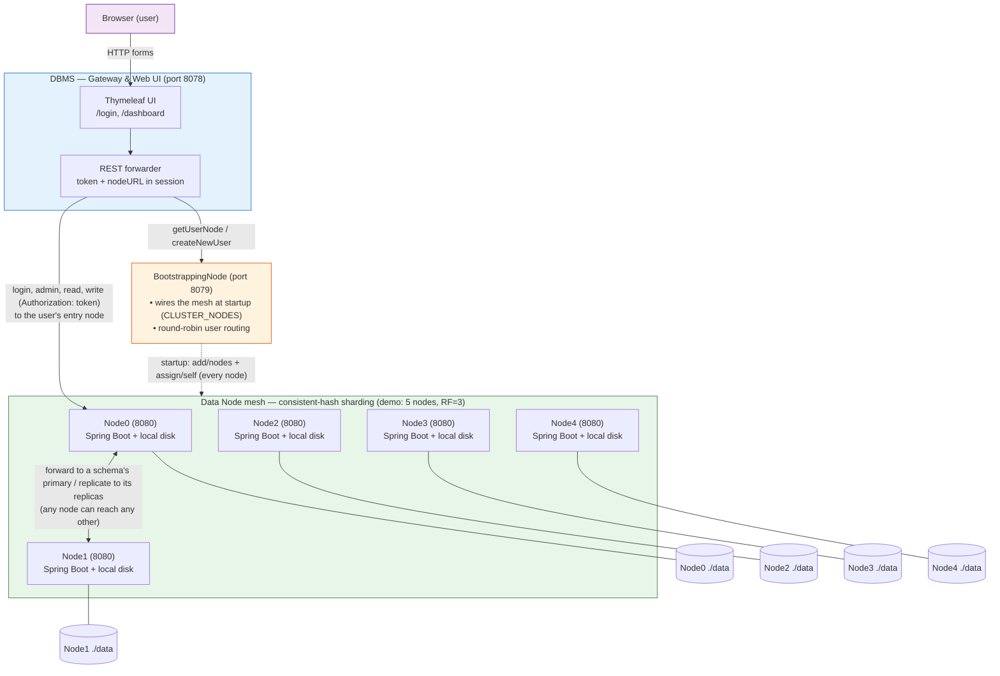
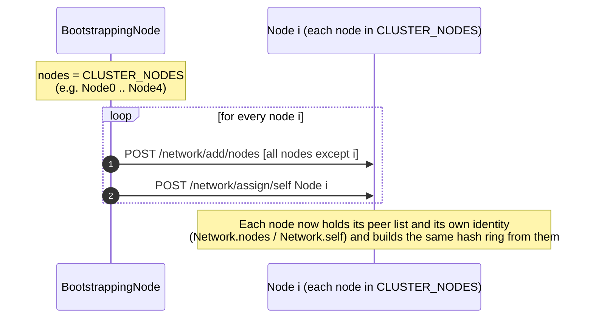
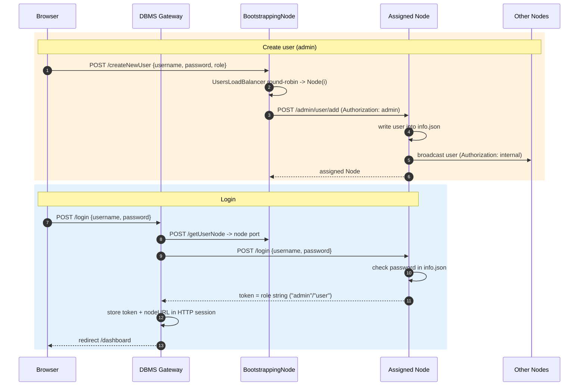
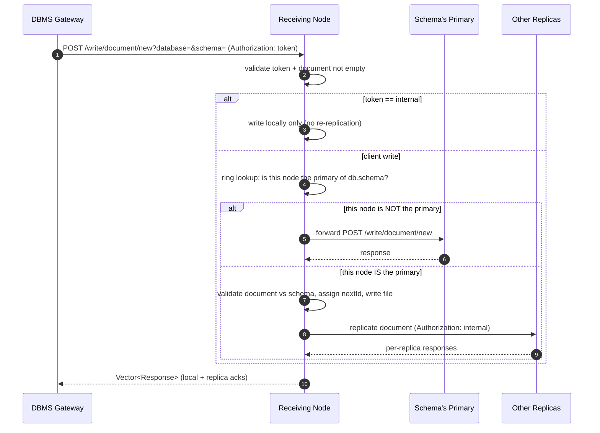
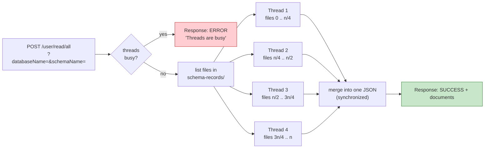
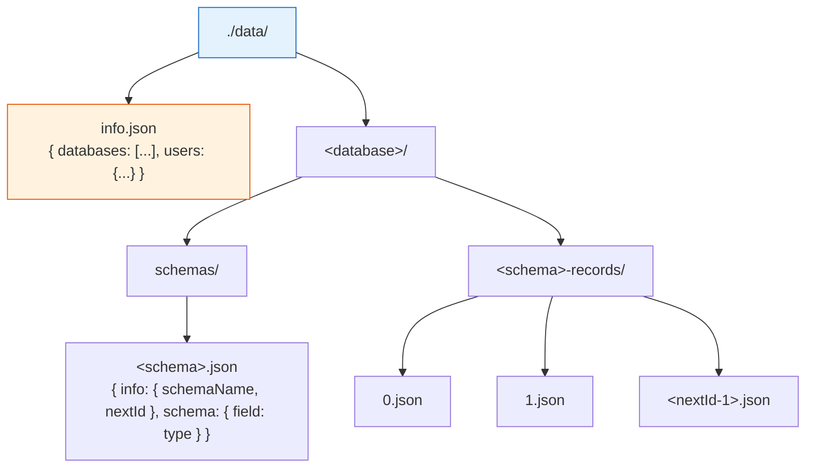

# NoSQL-Database — Decentralized Document Store (Java / Spring Boot)

A schema-enforced, **document-oriented NoSQL database** that runs as a small cluster of independent Java services. Data is stored as JSON files on each node's local disk, users are spread across nodes, and each schema is sharded onto a small set of replicas chosen by a consistent-hash ring (with virtual nodes).

> This project was built for learning distributed-systems and DBMS internals. The README below describes **what the code actually does today**, including the parts that are scaffolded but not yet wired in.

---

## Table of Contents

- [Architecture at a glance](#architecture-at-a-glance)
- [The three modules](#the-three-modules)
- [System architecture (diagram)](#system-architecture-diagram)
- [How the cluster forms (bootstrapping)](#how-the-cluster-forms-bootstrapping)
- [User routing & login](#user-routing--login)
- [Sharding & placement (consistent hashing)](#sharding--placement-consistent-hashing)
- [Writing a document (primary + replication)](#writing-a-document-primary--replication)
- [Reading documents (parallel read)](#reading-documents-parallel-read)
- [On-disk storage layout](#on-disk-storage-layout)
- [Data model & validation](#data-model--validation)
- [Ports](#ports)
- [HTTP API reference](#http-api-reference)
- [Build & run](#build--run)
- [Repository structure](#repository-structure)
- [Implemented vs. scaffolded](#implemented-vs-scaffolded)
- [Documentation](#documentation)

---

## Architecture at a glance

The system is **three separate Spring Boot applications** (Java 17, Spring Boot 2.7.6):

| Module | Role | Talks to |
|--------|------|----------|
| **DBMS** | Client-facing gateway + Thymeleaf web UI (login/dashboard). Holds no data. | BootstrappingNode + Data Nodes (via REST) |
| **BootstrappingNode** | Cluster coordinator: wires the node mesh at startup (from `CLUSTER_NODES`) and routes users to nodes (round-robin). | Data Nodes (via REST) |
| **Node** | The actual data node / storage engine. Stores JSON on local disk, authenticates users, places each schema on the hash ring, and replicates writes to the schema's replicas. | Every other Node in the mesh |

Key properties, as implemented:

- **Document store, not a plain key-value store.** Data is organized as `database → schema → document`, and documents are validated against a typed schema before they are stored.
- **Consistent-hash sharding by schema.** Each schema (its documents and its indexes) lives on `REPLICATION_FACTOR` replicas (default **3**, clamped to the cluster size). The replicas are picked by hashing `"<database>.<schema>"` onto a hash ring of virtual nodes (`VNODES_PER_NODE`, default **150**) and taking the next distinct nodes clockwise, so in a cluster larger than the replication factor a schema is stored on only *some* of the nodes. Placement is computed identically on every node — there is no central placement authority and no stored owner file.
- **Primary-coordinated writes.** The first replica on a schema's preference list is its **primary**. It coordinates the schema's writes (schema create, document create/update/delete) and replicates them to the schema's other replicas only. Any node can be the entry point: it forwards a write to the primary, and forwards reads, index queries, and index listings to a replica when it does not hold the schema itself.
- **Metadata stays fully replicated.** Database creation and user-add are still broadcast to **every** node, because every node needs the database directories and the user registry wherever the schemas land. *Users* are placed on an entry node round-robin by the BootstrappingNode.
- **Static membership.** The cluster is a fixed, fully-connected mesh of the nodes listed in `CLUSTER_NODES` (the Docker demo runs five: `Node0`–`Node4`), wired up by the BootstrappingNode at startup, and every node builds its ring from that membership. There is no dynamic discovery, failure detection, or live rebalancing.
- **File-based auth.** Users live in `info.json`; passwords are compared in plaintext; the "token" returned on login is simply the user's role string (`admin` / `user`).

---

## The three modules

### DBMS — gateway & web UI
A Spring MVC app (Thymeleaf) that a human uses through the browser. It stores **no data**. On login it asks the BootstrappingNode which node owns the user, authenticates against that node, and keeps the returned token + node URL in the HTTP session. Every subsequent admin/read/write action is forwarded to that node's REST API with the token in the `Authorization` header.

Controllers: `LoginController`, `DashboardController`, `AdminController` (`/admin/*`), `WriteController`.

### BootstrappingNode — coordinator & user router
On startup (`CommandLineRunner`) it builds the mesh: for each node in `CLUSTER_NODES` it POSTs the *other* nodes to `/network/add/nodes` and POSTs the node itself to `/network/assign/self`. It also creates users (round-robin placement via `UsersLoadBalancer`, replicated by the target node) and answers "which node owns this user?" queries.

### Node — data node / storage engine
Each node is autonomous and keeps its data on its local filesystem: every database directory and the user registry, plus the schemas (and their documents and indexes) that the hash ring places on it. Responsibilities:

- **Storage** as JSON files under `./data/` (`FileReader` / `FileWriter` / `FileUpdater`, `DirectoryManager`).
- **Authentication** against `info.json`; role-string tokens (`internal` / `admin` / `user`).
- **Schema placement & write coordination** (`HashRing`, `RingRouter`): the node hashes `"<database>.<schema>"` onto the ring to get the schema's replicas, primary first. If it receives a write for a schema whose primary is another node, it forwards the write there; the primary writes locally and replicates to the schema's other replicas.
- **Read routing**: a read, index query, or index listing is served locally if this node is a replica of the schema, otherwise it is forwarded to the schema's primary.
- **Replication** of schemas and documents to the schema's other replicas, and of databases and users to all peers, via thread-pool broadcasts. An `internal` token prevents re-broadcast loops.
- **Parallel reads**: `read/all` fans a schema's documents across 4 threads.
- **Validation** of schema field types and of documents against their schema.

---

## System architecture (diagram)



The DBMS forwards user-facing traffic to **one** node (the user's assigned *entry node*). That node serves the operation itself when it holds the schema, or hands it to the right node: a write goes to the schema's primary, which replicates it to the schema's other replicas; a read or index query goes to a replica. Database creation and user-add are broadcast to every node.

---

## How the cluster forms (bootstrapping)

Membership is not discovered — it is configured. At startup the BootstrappingNode reads the node list from the `CLUSTER_NODES` environment variable (comma-separated `host:port`; the Docker demo lists `Node0`–`Node4`, the local default is a single `localhost:8080`) and turns it into a fully-connected mesh where each node knows every other node and its own identity.



Each node keeps its peer list and identity in a static in-memory `Network` (`nodes`, `self`), plus the consistent-hash ring (`Network.ring`) built from `nodes ∪ {self}`. The ring is rebuilt whenever membership is (re)assigned through `/network/*`, from the same inputs on every node, so all nodes agree on where each schema lives. There is no heartbeat or re-join logic; if a node is down at startup, the corresponding call is skipped.

---

## User routing & login

Users are **spread** across nodes. The BootstrappingNode assigns each new user an entry node round-robin, and that node replicates the user record to the whole mesh (user-add is a full broadcast, not sharded by the ring) so any node can later authenticate it. The DBMS asks the BootstrappingNode which node a returning user belongs to, then logs in against that node.



> Note on tokens: the "token" is not a signed JWT — it is literally the user's role string. `Token.INTERNAL` (`internal`) is a reserved value used for node-to-node calls to prevent re-broadcast loops.

---

## Sharding & placement (consistent hashing)

Each schema is placed on the cluster by a **consistent-hash ring with virtual nodes** (`HashRing`). The whole schema — its documents *and* its B+-tree indexes — lives on its replicas, so a query still reaches one node that holds the complete data and index.

- **Ring.** Every physical node places `VNODES_PER_NODE` (default **150**) virtual points on a sorted ring, at the hash of `"<node name>#<i>"`. The hash is the first 8 bytes of an MD5 digest read as a long, which is stable across JVMs and evenly spread (unlike `String.hashCode`).
- **Placement.** A schema's key is `"<database>.<schema>"`. Hash it, then walk the ring clockwise (wrapping around) collecting **distinct physical nodes** until `REPLICATION_FACTOR` (default **3**) are found. That ordered list is the schema's **preference list**; the first node is its **primary**. The replication factor is clamped to the cluster size (and floored at 1), so a 3-node cluster at the default behaves like full replication, while the 5-node Docker demo stores each schema on 3 of the 5 nodes. A node with no peers is the primary and sole replica of everything.
- **No placement authority.** Every node builds the same ring from the shared membership (see [How the cluster forms](#how-the-cluster-forms-bootstrapping)), so each computes the same placement locally — nothing is stored per schema and no central service is consulted per request.
- **Minimal movement.** Because the ring is consistent, adding a node to the membership moves only about 1/n of the schemas to a new primary, not most of them as modulo placement would (asserted in `HashRingTest`). Membership is static, so there is no live rebalancing or data migration: set `REPLICATION_FACTOR` and `VNODES_PER_NODE` before creating data.

| Operation | Where it runs |
|-----------|---------------|
| Schema create; document create / update / delete | The schema's **primary**, then copied to the schema's **other replicas** only |
| Read by id, read all, index query, index list | Served by the entry node if it is a replica of the schema; otherwise forwarded to the schema's primary |
| Index create / drop | The primary, then the schema's other replicas (exactly the nodes that hold its data) |
| Database create, user add | **Broadcast to every node** (cluster-wide metadata is not sharded) |

| Setting | Default | Meaning |
|---------|---------|---------|
| `REPLICATION_FACTOR` | `3` | Number of nodes that hold a copy of each schema (clamped to the cluster size) |
| `VNODES_PER_NODE` | `150` | Virtual nodes each physical node places on the ring (smoother balance) |

Replication is synchronous and best-effort: a write waits for the available replicas, and an unreachable replica surfaces as an error response without rolling back the others. There is no quorum, read-repair, or hinted handoff.

---

## Writing a document (primary + replication)

Each schema has a **primary** — the first node on its preference list, responsible for coordinating writes to that schema. Any node can receive a client write. If it is not the schema's primary, it forwards the write to the primary (carrying the caller's token). The primary writes locally, then replicates the document to the schema's **other replicas** only, so all copies of that schema stay in sync. Nodes that are not replicas of the schema never receive the document.



Schema creation and document update/delete are routed the same way: forwarded to the primary, applied there, then copied to the other replicas. Database creation is different: the receiving node applies the change locally, then propagates it to **all** peers (user-add works the same way), since every node needs the database directory regardless of where schemas land. Broadcasts and replication use a thread pool, and `synchronized` blocks guard the file writes on each node.

Document IDs are sequential integers per schema, tracked by a `nextId` counter stored in the schema file.

---

## Reading documents (parallel read)

Reads are served from the local disk of a replica of the schema: the entry node serves the read itself if it holds the schema, and otherwise forwards it to the schema's primary. `read/all` splits the schema's document files into four contiguous ranges and reads them concurrently with four threads.



`read/document` (by id) is a simple single-file read. Both endpoints require a valid user token.

---

## On-disk storage layout

Every node stores its data under `./data/` (see `PathBuilder`). `info.json` holds the registry of databases and users, which every node has in full. Each database directory exists on every node, but a node only holds the `schemas/` entries and per-schema record folders of the schemas the ring places on it.



Concrete paths:

```
./data/info.json                              # databases list + users
./data/<database>/schemas/<schema>.json       # schema definition + nextId (only on the schema's replicas)
./data/<database>/<schema>-records/<id>.json  # one document per file (only on the schema's replicas)
```

There is no per-schema owner/placement file: which nodes hold a schema is computed from the hash ring, not stored.

---

## Data model & validation

A **schema** maps field names to types, restricted to `String`, `Integer`, `Double`, `Boolean` (`Validators.validateSchema`). A **document** is validated against its schema before it is written (`Validators.validateDocument`): every schema field must be present, non-null, and of the matching Java type.

Example schema definition:

```json
{
  "info":   { "schemaName": "users", "nextId": 3 },
  "schema": { "Name": "String", "Age": "Integer", "Active": "Boolean" }
}
```

Example stored document (`2.json`):

```json
{ "Name": "Marya", "Age": 27, "Active": true }
```

---

## Ports

Ports come from the code and container scripts, not the (inconsistent) `application.properties` files:

| Service | Port | Source |
|---------|------|--------|
| DBMS (gateway/UI) | **8078** | `DbmsApplication` `WebServerFactoryCustomizer` |
| BootstrappingNode | **8079** | `run.sh` (`-p 8079:8080`); DBMS calls `http://localhost:8079` |
| Data nodes | **8080** (each node) | `CLUSTER_NODES` (`host:port` list); `docker-compose.yml` |

Inside the Docker network, nodes address each other by service name (`Node0` … `Node4` in the demo) on port `8080`. When running outside Docker, the DBMS addresses nodes at `http://localhost:<port>`.

---

## HTTP API reference

### DBMS gateway (browser-facing, port 8078)

| Method | Path | Purpose |
|--------|------|---------|
| GET | `/login` | Login page |
| POST | `/login` | Authenticate; stores token + nodeURL in session |
| GET | `/dashboard` | Dashboard (create DB, add user, create schema) |
| POST | `/admin/createDatabase` | Create a database (forwarded to user's node) |
| POST | `/admin/addUser` | Add a user (forwarded to user's node) |
| POST | `/createSchema` | Create a schema (forwarded to user's node) |

### BootstrappingNode (port 8079)

| Method | Path | Purpose |
|--------|------|---------|
| POST | `/createNewUser` | Round-robin place a new user on a node, then replicate |
| POST | `/getUserNode` | Return the port of the user's assigned node |
| GET | `/test` | Health check |

### Data Node (port 8080+)

| Method | Path | Purpose |
|--------|------|---------|
| POST | `/login` | Authenticate against `info.json`; returns role token |
| POST | `/admin/user/add` | Add user locally; broadcast to all nodes if caller is admin |
| POST | `/admin/database/create?databaseName=` | Create database locally; broadcast to all nodes if admin |
| POST | `/write/schema/new?database=` | Forward to the schema's primary, create schema, replicate to its other replicas |
| POST | `/write/document/new?database=&schema=` | Forward to the schema's primary, write, replicate to its other replicas |
| POST | `/user/read/document?id=&databaseName=&schemaName=` | Read one document by id (served by a replica, else forwarded) |
| POST | `/user/read/all?databaseName=&schemaName=` | Read all documents (4 threads; served by a replica, else forwarded) |
| POST | `/network/add/node` | Add a single peer |
| POST | `/network/add/nodes` | Set the peer list |
| POST | `/network/assign/self` | Set this node's identity |
| GET | `/network/get/nodes` | List peers |
| GET | `/user/network/get/self` | Return this node's identity |
| ANY | `/test`, `/test/broadcast` | Diagnostics |

All node data endpoints require an `Authorization` header carrying a role token (`admin`, `user`, or `internal`).

---

## Build & run

**Prerequisites:** JDK 17, Maven (wrappers `mvnw` are included), and Docker (for the provided scripts).

### With Docker (provided scripts)

The scripts wrap `docker compose`: one image is built from the root `Dockerfile` and started in different roles — five data nodes (`Node0`–`Node4`), the BootstrappingNode, and the DBMS gateway.

```bash
# Build and start the whole cluster (then open http://localhost:8078/login)
./run.sh

# Rebuild the image and restart the cluster in the background
./rebuild.sh

# Tear everything down
./stop.sh
```

> The demo runs 5 data nodes with `REPLICATION_FACTOR=3`, so each schema lives on 3 of the 5 nodes. The node list is `CLUSTER_NODES`, set identically on the coordinator and every node in `docker-compose.yml`. See [`RUN.md`](./RUN.md) for the roles, the `REPLICATION_FACTOR` / `VNODES_PER_NODE` settings, and the single-node local run.

### From an IDE / command line

Each module is an independent Spring Boot app. Start them in this order:

```bash
# Data node(s) (a single node by default; for a cluster, run more instances and list them in CLUSTER_NODES)
cd Node && ./mvnw spring-boot:run

# Coordinator
cd BootstrappingNode && ./mvnw spring-boot:run

# Gateway + UI, then open http://localhost:8078/login
cd DBMS && ./mvnw spring-boot:run
```

The BootstrappingNode addresses data nodes by the `CLUSTER_NODES` list (default `localhost:8080`, a single node), so running a multi-node cluster fully outside Docker requires listing hostnames/ports that match your setup. With one node and no peers, the ring places every schema on that node.

---

## Repository structure

```
.
├─ BootstrappingNode/     # Coordinator: mesh setup (CLUSTER_NODES) + round-robin user routing
│  └─ src/main/java/.../  # BootstrappingNodeApplication, UserController, UsersLoadBalancer, models
├─ DBMS/                  # Gateway + Thymeleaf UI (login/dashboard); holds no data
│  └─ src/main/
│     ├─ java/.../        # controllers, services, database_system (connection/read/write/admin)
│     └─ resources/templates/  # login.html, dashboard.html
├─ Node/                  # Data node / storage engine
│  └─ src/main/java/.../
│     ├─ controllers/     # network, admin, authentication, read, write, test
│     ├─ services/        # admin, authentication (+ RSAEncryption), read (+ indexing), write
│     ├─ operations/      # admin & write file operations
│     ├─ model/           # Node, Network, User
│     └─ utils/           # ring/ (HashRing, RingRouter, RingConfig), Forwarder, PathBuilder, Token,
│                         #   Validators, cache/ (LRU scaffold), directory/, file_operations/, response/
├─ docker-compose.yml     # 5 data nodes (RF=3) + BootstrappingNode + DBMS, one image
├─ rebuild.sh             # Rebuild the image + restart the cluster (docker compose up --build -d)
├─ run.sh                 # Build + start the cluster (docker compose up --build)
├─ stop.sh                # Remove containers + network (docker compose down)
├─ Decentralized Cluster (Haifawi).pdf
└─ NoSql DB.pdf
```

---

## Implemented vs. scaffolded

To keep this honest, here is what exists in the codebase but is **not yet functional**:

| Component | Status |
|-----------|--------|
| Document store, schema validation, typed fields | ✅ Implemented |
| Static mesh from `CLUSTER_NODES` + startup wiring | ✅ Implemented |
| User placement (round-robin) + login routing | ✅ Implemented |
| Consistent-hash ring with virtual nodes; each schema on `REPLICATION_FACTOR` replicas | ✅ Implemented |
| Primary-coordinated writes replicated to the schema's other replicas | ✅ Implemented |
| Read / index-query / index-list routing to a replica | ✅ Implemented |
| Full broadcast of databases and users to all nodes | ✅ Implemented |
| Parallel `read/all` (4 threads) | ✅ Implemented |
| **LRU cache** (`Cache`, `DoubleLinkedList`) | ⚠️ Scaffolded — `add/get/remove/clear` are empty stubs; injected but unused |
| **IndexingService** | ⚠️ Empty class |
| **`RSAEncryption`** | ⚠️ Present but not wired into any request flow (and uses a symmetric key, not RSA) |
| **Spring Security / JWT filter** | ⚠️ Commented out in `NodeApplication`; tokens are plain role strings |
| Dynamic discovery / failure detection / quorum | ❌ Not present (membership is static) |
| Live rebalancing / data migration when membership or the ring settings change | ❌ Not present (set `REPLICATION_FACTOR` / `VNODES_PER_NODE` before creating data) |

---

## Documentation

Design write-ups included in the repo:

- [Decentralized Cluster (Haifawi).pdf](./Decentralized%20Cluster%20(Haifawi).pdf)
- [NoSql DB.pdf](./NoSql%20DB.pdf)****
